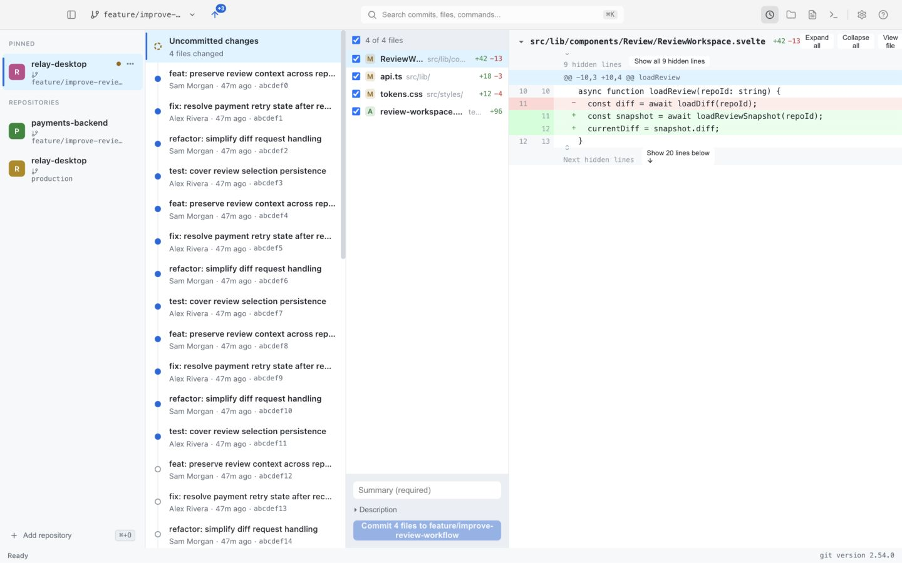
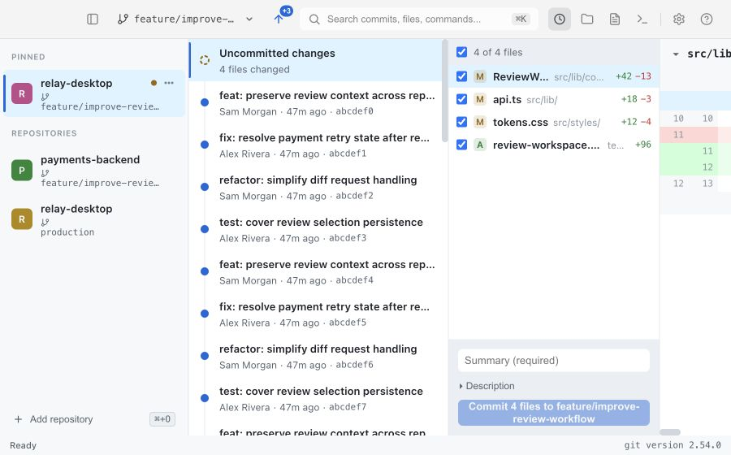
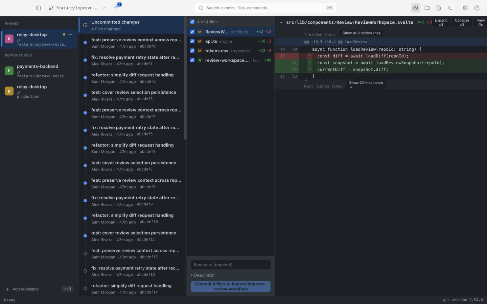

# Relay production review — 16 October 2026

Relay has a useful product direction and a reasonable Tauri/Rust/Svelte foundation. The current workspace is not ready for a production release. The highest risks concern which repository, branch, files, and revision an action actually affects. Visual polish should proceed alongside those corrections, with Git safety taking release priority.

This review covers the current working tree, including the uncommitted UI redesign. It combines source inspection, codebase-memory structure/coverage checks, frontend checks, Rust checks, a separate backend review, disposable Git fixtures, and browser inspection of the current components using fabricated repositories. The running native bundle displayed an older interface; its appearance was not treated as evidence of the current redesign. No real repository was committed, reset, discarded, checked out, pushed, or otherwise modified for this review. Only this report and its images were added to the workspace.

Evidence labels: **Reproduced** means exercised in the isolated UI or disposable Git fixtures; **Source** means confirmed implementation behavior; **Design** means a proposed improvement rather than a demonstrated bug. P1 means resolve before release or a dependable daily-use beta; P2 means important workflow/quality work; P3 means polish or later enhancement. These are review priorities, not estimates of exploitability.

Existing strengths worth preserving include the typed IPC wrapper, separate Rust Git modules, per-repository operation locking infrastructure, semantic CSS tokens, shared control components, system-font typography, reduced-motion CSS, working split-diff rendering and inline-note creation, startup watcher registration, and the selective-commit regression test for repositories with an existing HEAD. The older prototype review predates several of these improvements.

Validation performed on this working tree:

| Check | Result | Practical limit |
|---|---|---|
| `npm run check` | Passed: 0 errors, 0 warnings | Does not establish workflow correctness or accessibility |
| `npm test` | Passed: 19 tests across 5 files | Tests cover helpers; no mounted component or desktop workflow coverage in the inspected suite |
| `npm run build` | Passed | Vite warned about a 561.31 kB minified JS chunk, 160.46 kB gzip; CSS 75.29 kB |
| `cargo test --manifest-path src-tauri/Cargo.toml` | Passed: 20 tests | Several missing safety cases were reproduced independently |
| `cargo clippy --manifest-path src-tauri/Cargo.toml -- -D warnings` | Passed | Static linting does not establish transaction safety |
| `cargo fmt --manifest-path src-tauri/Cargo.toml -- --check` | Failed | Formatting differences in command, diff, operation, status, and watcher files |
| Current UI, 1440 × 900 and 900 × 560 | Inspected using isolated sample data | Browser inspection does not verify native window chrome, VoiceOver, signing, or Windows/Linux behavior |

**Visual evidence.** These screenshots use fabricated repository/commit/file data and the current source components. They demonstrate layout and theme behavior, not backend correctness.







**Detailed improvement list**

1. **R01 · P1 · Enforce branch identity for every write. Source.** A branch view can describe one branch while a write operates on the branch checked out at the shared path. Inactive branch status clears its upstream; the current header consequently offers Publish, while backend publish uses current HEAD. Viewing `feature` with `main` checked out can publish `main`. Make inactive views read-only, create real worktrees, or use explicit ref-aware operations. Validate the expected branch/HEAD under the backend operation lock. Acceptance: a branch changing between display and click cannot redirect a write. Evidence: [TopHeader.svelte:61](../src/lib/components/Header/TopHeader.svelte:61), [status.rs:196](../src-tauri/src/git/status.rs:196), [cmd.rs:833](../src-tauri/src/cmd.rs:833), [refs.rs:98](../src-tauri/src/git/refs.rs:98).

2. **R02 · P1 · Treat selected filenames literally. Reproduced.** `--` separates options but filenames still act as Git pathspec patterns. In a disposable repository, discarding the valid filename `*.txt` also discarded edits to the unselected `other.txt`. Apply Git's literal-pathspec mode consistently to filename-based read/write operations; preserve raw filenames instead of building shell strings. Acceptance: wildcard characters, pathspec magic, leading dashes, spaces, Unicode, and newline-containing filenames affect exactly the selected paths. Evidence: [ops.rs:87](../src-tauri/src/git/ops.rs:87), [ops.rs:216](../src-tauri/src/git/ops.rs:216).

3. **R03 · P1 · Remove shell interpolation from external-editor launching. Source.** Repository paths and tracked filenames are substituted into a command passed to `sh -c` or `cmd /C`. Spaces can break editor opening; shell metacharacters or substitutions in a repository-controlled filename can become executable syntax. Parse configuration into an executable and argument template, then substitute values into individual arguments. Acceptance: hostile-looking filenames are opened literally. No exploit was executed during this review. Evidence: [cmd.rs:1063](../src-tauri/src/cmd.rs:1063).

4. **R04 · P1 · Make selected-file root commits safe. Reproduced.** The root-commit fallback stages selected paths and then commits the entire index. A fixture with an unselected, previously staged `secret.txt` and selected `chosen.txt` committed both. Use a temporary index or equivalent transaction that builds exactly the selected tree and preserves the original index. Acceptance: root commits, existing commits, partial staging, and unselected staged additions/deletions all honor the same selection contract. Evidence: [ops.rs:118](../src-tauri/src/git/ops.rs:118).

5. **R05 · P2 · Preserve both sides of a selected rename. Reproduced.** Committing only a renamed file's new path left both old and new names in HEAD and the old deletion staged. Pass the change identity, including `oldPath`, to the commit transaction rather than reducing selection to new filenames. Acceptance: a selected rename commits the removal and addition together; unrelated staged changes remain staged. Evidence: [ops.rs:87](../src-tauri/src/git/ops.rs:87), [api.ts:159](../src/lib/api.ts:159).

6. **R06 · P1 · Enforce reset consent and backup success in the backend. Source.** Reset always uses `--hard`; `also_discard_dirty` only determines whether a stash is attempted. Edits arriving after the frontend's cached dirty check can be discarded even when that flag is false. Required backup failures are ignored. Recheck status immediately before mutation in one repository transaction, reject unexpected dirty state, and abort if recovery capture fails. Acceptance: edits made while the confirmation is open are preserved or trigger a fresh confirmation. Evidence: [ops.rs:372](../src-tauri/src/git/ops.rs:372), [ResetDialog.svelte:143](../src/lib/components/Dialogs/ResetDialog.svelte:143).

7. **R07 · P1 · Restore reset backups according to their actual type. Reproduced.** Dirty reset creates separate HEAD and stash refs; reset returns only the HEAD backup ref, so normal Undo restores HEAD without reapplying the saved dirty state. Restore dispatches by whether a ref contains `reset`, so restoring a `reset-dirty` stash resets the branch to the stash merge commit. A fixture confirmed a two-parent stash HEAD and clean status after this path. Store typed metadata and restore HEAD, index, and worktree deliberately. Protect edits made since reset. Acceptance: Undo restores original branch history and staged/unstaged content without adding a stash merge to branch history. Evidence: [ops.rs:391](../src-tauri/src/git/ops.rs:391), [ops.rs:458](../src-tauri/src/git/ops.rs:458).

8. **R08 · P1 · Make partial-discard Undo work. Reproduced.** Discard snapshots all tracked dirty files but removes only selected paths. Applying that full stash for Undo can fail when unselected dirty files remain. Fixture: edit `a` and `b`, discard `a`, Undo fails because `b` would be overwritten, and `a` stays discarded. Capture and restore the selected paths with their index/worktree state. Acceptance: discarding and undoing one file leaves every unselected edit intact. Evidence: [ops.rs:176](../src-tauri/src/git/ops.rs:176), [ops.rs:470](../src-tauri/src/git/ops.rs:470).

9. **R09 · P1 · Complete untracked-file recovery. Source.** Discard attempts to move untracked files to `.git/relay-trash`, but restore handles refs rather than trash contents. An untracked-only discard has no corresponding stash ref. Directory creation and rename errors are ignored, and linked worktrees have a `.git` file rather than the assumed directory. Resolve the real Git directory, record a manifest of original paths, propagate move failures, and implement restore including collisions. Acceptance: every successful discard produces a listed, restorable backup. Evidence: [ops.rs:226](../src-tauri/src/git/ops.rs:226), [ops.rs:458](../src-tauri/src/git/ops.rs:458).

10. **R10 · P1 · Mark the displayed snapshot as reviewed. Source.** The palette marks the current branch tip at click time, while the displayed data may predate a new agent commit. Capture a concrete end SHA when a review opens, mark that SHA, and leave later commits pending. Reload the stored marker and offer Undo. Acceptance: a commit arriving during review remains visibly unreviewed. Evidence: [CommandPalette.svelte:136](../src/lib/components/Palette/CommandPalette.svelte:136), [cmd.rs:359](../src-tauri/src/cmd.rs:359).

11. **R11 · P1 · Prevent stale asynchronous results from replacing current content. Source.** History, file-list, and diff requests assign their results without checking whether the repository, selected SHA, scope, or path still matches. Old content also remains visible while a new request runs. Use request generations keyed by the complete review identity, clear or explicitly mark pending content, and ignore superseded results. Apply the same rule to CodeViewer and branch loading. Acceptance: rapid A→B→A selection with reversed response order never pairs one context with another context's content. Evidence: [Pane.svelte:90](../src/lib/components/Pane/Pane.svelte:90), [Pane.svelte:137](../src/lib/components/Pane/Pane.svelte:137), [CodeViewer.svelte:113](../src/lib/components/Viewer/CodeViewer.svelte:113).

12. **R12 · P1 · Refresh the visible workspace, not only badges. Source.** The repository store updates status after events, but Pane reloads history only when the repository ID changes. External commits, checkouts, and file edits can leave an open diff/history stale. The commit callback fetches a fresh status but discards it before reloading against the old prop. Introduce explicit invalidation for history, working files, diff, and tree caches; preserve selection when possible. Rebind watcher state when marker/path/branch changes. Acceptance: external edits and commits become visible without reselection or restart. Evidence: [repos.ts:61](../src/lib/stores/repos.ts:61), [Pane.svelte:70](../src/lib/components/Pane/Pane.svelte:70), [Pane.svelte:254](../src/lib/components/Pane/Pane.svelte:254), [watch.rs:84](../src-tauri/src/watch.rs:84).

13. **R13 · P1 · Bind the terminal UI lifecycle to repository identity. Source.** Pane reuses TerminalDrawer as repository props change, while terminal creation occurs only in `onMount`. Headers and input callbacks can refer to the new repository while the initial xterm contents/session belong to the previous one. Key the terminal component by stable session/repository identity or reconnect deliberately on identity changes. Wait for a ready session before pasting review notes. Acceptance: switching repositories with the drawer open always shows and writes to the named repository's session. Evidence: [Pane.svelte:307](../src/lib/components/Pane/Pane.svelte:307), [TerminalDrawer.svelte:27](../src/lib/components/Terminal/TerminalDrawer.svelte:27), [NotesPanel.svelte:59](../src/lib/components/Notes/NotesPanel.svelte:59).

14. **R14 · P2 · Surface persistence failures. Source.** Many backend commands ignore `save()` failures; startup discards the persistence load warning. Settings also update optimistically and only log a failed save. Users can receive success then lose settings, notes, markers, or repository registration at restart. Return persistence errors, expose corruption recovery, and reconcile memory/disk state. Retain the existing atomic-rename approach while testing failure paths and future state-version migrations. Acceptance: a denied/full disk never produces an unqualified saved message. Evidence: [cmd.rs:43](../src-tauri/src/cmd.rs:43), [cmd.rs:1018](../src-tauri/src/cmd.rs:1018), [settings.ts:28](../src/lib/stores/settings.ts:28), [persist.rs:94](../src-tauri/src/persist.rs:94).

15. **R15 · P2 · Terminate timed-out Git processes before releasing operation ownership. Source.** `timeout(cmd.output())` lacks kill-on-drop or explicit child termination. Installed Tokio defaults do not kill the child on drop. A timed-out hook/signing/fetch/push can continue after the app reports failure and releases its lock. Retain an owned child, kill/reap on timeout, and keep the repository transaction locked until termination completes. Acceptance: timeout and Retry cannot produce overlapping writes or a late unexpected commit/push. Evidence: [runner.rs:97](../src-tauri/src/git/runner.rs:97).

16. **R16 · P1 · Reconcile the one-pane UI with the three-pane command/state model. Source.** App renders only pane zero, while modifier-click, palette commands, saved layouts, focus, and stores still support three panes. Modifier-click can focus an invisible pane; the header then follows that pane while the visible content stays on pane zero. Either restore the complete multi-pane renderer or consistently adopt one workspace and remove hidden-pane behavior. Acceptance: every selection and command affects the visible workspace and modifier-click has a documented, visible result. Evidence: [App.svelte:33](../src/App.svelte:33), [App.svelte:137](../src/App.svelte:137), [TopHeader.svelte:16](../src/lib/components/Header/TopHeader.svelte:16), [panes.ts:87](../src/lib/stores/panes.ts:87).

17. **R17 · P1 · Carry navigation targets all the way to the destination. Reproduced and Source.** In the isolated UI, View file did not leave the diff; the handler mutates a nested store value and ignores the requested path. The separate Files button opened the first file. Palette file/commit results similarly switch tabs and show a success toast without selecting the requested item; definition navigation drops target line in FilesTab. Introduce a typed navigation target containing repository, revision, path, side, line, and commit as appropriate. Acceptance: every result opens the named destination and its stated revision/line. Evidence: [Pane.svelte:283](../src/lib/components/Pane/Pane.svelte:283), [CommandPalette.svelte:541](../src/lib/components/Palette/CommandPalette.svelte:541), [FilesTab.svelte:109](../src/lib/components/Pane/FilesTab.svelte:109).

18. **R18 · P1 · Restore the core combined-review workflow. Source.** Pane selects working changes or a single latest commit; it does not expose the combined marker→snapshot range as its default review. RangeHeader, including marker recovery/triage work, exists but is not mounted in the current Pane. Add a visible Needs review mode with stable range endpoints, commit count, summary, mark-reviewed action, and missing/diverged marker recovery independent of count. Acceptance: someone can perform the README's core loop entirely from the visible interface. Evidence: [Pane.svelte:90](../src/lib/components/Pane/Pane.svelte:90), [Pane.svelte:198](../src/lib/components/Pane/Pane.svelte:198), [RangeHeader.svelte:1](../src/lib/components/Pane/RangeHeader.svelte:1).

19. **R19 · P2 · Make diff controls reload the correct data. Source.** Ignore-whitespace/context settings are read when requesting a diff but do not trigger a new request when changed. Load diff anyway calls the same path that always passes `force: false`. Working-change context expansion uses a commit/branch revision rather than the exact displayed worktree snapshot. Binary changes can reach a misleading No changes message. Centralize scope state and fetching; pass a real force flag; handle binary, mode-only, deleted, truncated, and error states explicitly. Acceptance: each control visibly changes the intended data without mixing revisions. Evidence: [Pane.svelte:137](../src/lib/components/Pane/Pane.svelte:137), [Pane.svelte:286](../src/lib/components/Pane/Pane.svelte:286), [DiffView.svelte:335](../src/lib/components/Diff/DiffView.svelte:335), [DiffView.svelte:563](../src/lib/components/Diff/DiffView.svelte:563).

20. **R20 · P2 · Anchor notes to a revision and side. Source.** Inline notes always set `commitSha: null` and displayed notes filter by path alone. Notes on the same filename from a different commit can appear on unrelated lines. Copied references and prompt export omit the old/new side and useful repository/branch/revision identity. Persist the exact review snapshot, side, range, and snippet; detect outdated anchors. Acceptance: historical/deleted-line feedback remains unambiguous after subsequent commits. Evidence: [DiffView.svelte:52](../src/lib/components/Diff/DiffView.svelte:52), [DiffView.svelte:162](../src/lib/components/Diff/DiffView.svelte:162), [format.ts:116](../src/lib/format.ts:116).

21. **R21 · P2 · Preserve note drafts and update notes atomically. Source.** Inline note failure is logged and the editor is cleared anyway. Editing a saved note deletes it before adding its replacement; failure between the calls loses the original. Keep drafts on failure and provide one backend update command. Validate range ordering and support resolved/outdated states. Acceptance: failed save/edit leaves the original note and draft recoverable, with a visible retry. Evidence: [DiffView.svelte:174](../src/lib/components/Diff/DiffView.svelte:174), [NoteEditor.svelte:86](../src/lib/components/Notes/NoteEditor.svelte:86).

22. **R22 · P2 · Enumerate untracked files instead of collapsed directory entries. Reproduced.** Working status uses `--untracked-files=normal`, returning entries such as `newdir/`; no-index diff then treats that directory as a file and can return an empty diff after a Git error. A fixture reproduced `Could not access 'newdir/null'`. Use file-level enumeration and visible error handling. Acceptance: a newly added folder allows each file to be reviewed, selected, and committed independently. Evidence: [diff.rs:432](../src-tauri/src/git/diff.rs:432), [diff.rs:505](../src-tauri/src/git/diff.rs:505).

23. **R23 · P1 · Protect a usable minimum width for the diff. Reproduced.** At the configured 900 px minimum, default sidebar/history/files widths are 232+320+260 px, leaving only 88 px for the diff. Resizing exists, but users should not need to repair the layout. Collapse or combine history/files below a content-width threshold, offer a focus-diff action, constrain all splitter widths against the viewport, and restore valid widths on resize/restart. Acceptance: 900×560, 1280×800, and 1440×900 all provide readable content and reachable actions. Evidence: [Pane.svelte:29](../src/lib/components/Pane/Pane.svelte:29), [App.svelte:39](../src/App.svelte:39), [tauri.conf.json:21](../src-tauri/tauri.conf.json:21).

24. **R24 · P2 · Give filenames priority over directory metadata and badges. Reproduced and Design.** A 260 px file column splits one row between status, checkbox, basename, directory, triage, and statistics; the identifying basename truncates early. Show the basename on its own primary line, place a shortened directory below or on hover, and move low-priority metrics into an optional detail area. Include full-path tooltips and distinguish renamed paths. Acceptance: similarly named files remain identifiable without opening each one. Evidence: [FileList.svelte:225](../src/lib/components/Pane/FileList.svelte:225), [FileList.svelte:362](../src/lib/components/Pane/FileList.svelte:362).

25. **R25 · P1 · Restore useful sidebar attention signals and group related views. Source and Design.** Current RepoRow computes pane indicators but renders neither them nor new-commit counts/errors. The same repository appears as unrelated branch rows with different avatar colors, while its long branch often truncates. Group views/worktrees beneath one repository identity, show explicit unreviewed counts and errors, differentiate browsing from checked-out state, and make filtering available consistently rather than only at seven repositories. Preserve a stable manual/pinned order while users interact. Acceptance: a 20-repository workspace reveals what needs attention and which physical checkout a view represents. Evidence: [RepoRow.svelte:26](../src/lib/components/Sidebar/RepoRow.svelte:26), [RepoRow.svelte:166](../src/lib/components/Sidebar/RepoRow.svelte:166), [Sidebar.svelte:78](../src/lib/components/Sidebar/Sidebar.svelte:78).

26. **R26 · P2 · Keep repository identity visible in the toolbar. Source and Design.** The current header shows a branch pill and remote-action icon but no active repository name when a repository exists. Identical branch names across projects become difficult to distinguish, especially with a collapsed sidebar. Use a compact repository title plus branch/view context and a path/worktree disambiguator on demand. Preserve the complete branch in a tooltip rather than only Switch branch. Acceptance: the active repository and operation target are clear with the sidebar hidden. Evidence: [TopHeader.svelte:144](../src/lib/components/Header/TopHeader.svelte:144).

27. **R27 · P2 · Use labeled navigation for the main modes. Design.** A clock and folder are compact but require users to learn that they mean History and repository Files. Distinguish main destinations with a small labeled segmented control, keep Notes/Terminal as utility toggles, and expose the active state programmatically. Reserve icon-only buttons for familiar secondary actions. This follows Apple's guidance to choose toolbar items deliberately and group them logically. Acceptance: first-time users can identify Changes/Review, History, and Files without hovering. Evidence: [TopHeader.svelte:302](../src/lib/components/Header/TopHeader.svelte:302); [Apple toolbar guidance](https://developer.apple.com/design/human-interface-guidelines/toolbars).

28. **R28 · P2 · Simplify the commit form and clarify selection. Reproduced and Design.** The long Commit N files to branch label wraps within a fixed 32 px button. Selection defaults to all files on every scope load, and select-all lacks an indeterminate state. Keep a concise Commit N files action, put branch/destination in a stable line above it, preserve deliberate selections, label Summary/Description explicitly, and explain disabled state. Show only the selected diff to the commit-message helper. Acceptance: long branches, zero selection, generation failure, and commit progress have stable layouts and clear consequences. Evidence: [CommitBox.svelte:67](../src/lib/components/Pane/CommitBox.svelte:67), [CommitBox.svelte:117](../src/lib/components/Pane/CommitBox.svelte:117), [FileList.svelte:170](../src/lib/components/Pane/FileList.svelte:170).

29. **R29 · P2 · Finish history browsing and commit details. Source and Design.** History loads only the first 200 commits without paging or an inline search. The current CommitRow omits triage flags and a detail surface for long subject/body/stats; every row is separately tabbable. Add paging, a history filter, selected-commit metadata, copy SHA, and advisory flags from the backend. Keep the timeline quiet, with a clear reviewed boundary. Acceptance: an older commit beyond the first page can be found and reviewed with its full message. Evidence: [Pane.svelte:93](../src/lib/components/Pane/Pane.svelte:93), [CommitRow.svelte:23](../src/lib/components/Pane/CommitRow.svelte:23).

30. **R30 · P2 · Design separate startup, empty, loading, unavailable, and failed states. Source and Design.** Many failures are logged or swallowed; an empty file/diff can look like a successful no-change result. The initial no-repository message offers a keyboard instruction but no direct add/browse action. Add visible retry states, a useful onboarding action, a specific clean-working-tree message, missing-repository relocation, Git-unavailable guidance, and stale/offline indicators. Acceptance: the user can tell no data from failed data without opening a console. Evidence: [Pane.svelte:102](../src/lib/components/Pane/Pane.svelte:102), [FilesTab.svelte:33](../src/lib/components/Pane/FilesTab.svelte:33), [App.svelte:72](../src/App.svelte:72).

31. **R31 · P2 · Finish one coherent icon system. Source and Design.** The new typed SVG Icon wrapper is a good base, but emoji sparkle, text chevrons, refresh glyphs, and custom utility buttons remain. The SVGs are custom paths despite SF Symbol comments; use accurate names/documentation and choose either the existing wrapper or the installed Lucide library as the source. Standardize optical size, stroke, baseline, and hit area; use text or accessible names for meaning. Acceptance: no platform-dependent glyphs perform the same job as a different SVG elsewhere. Evidence: [Icon.svelte:1](../src/lib/components/common/Icon.svelte:1), [CommitBox.svelte:81](../src/lib/components/Pane/CommitBox.svelte:81), [SettingsDialog.svelte:295](../src/lib/components/Dialogs/SettingsDialog.svelte:295).

32. **R32 · P3 · Make repository avatars stable and restrained. Source and Design.** Colors hash the entry UUID, so branch views of one physical repository receive unrelated colors. Saturated red/amber/green avatars also compete with semantic error/warning/dirty indicators. Hash canonical repository identity, allow an optional user color, and use quieter fills with a tested foreground. The comment claiming AA contrast for every palette color is not accurate for normal white text on amber/blue. Acceptance: the same repository remains recognizable across branch views, and avatars never resemble status signals. Evidence: [RepoRow.svelte:26](../src/lib/components/Sidebar/RepoRow.svelte:26), [format.ts:43](../src/lib/format.ts:43).

33. **R33 · P3 · Validate the app icon and branding at actual delivery sizes. Design.** The blue linked-circle mark is simple and scalable, but its relationship to Relay/review is not self-evident. Verify recognition in the Dock, Finder, installer, About dialog, and small task-switcher sizes; align the product mark with the UI's restrained accent. Keep the master vector and generated platform assets organized. Mobile icon outputs are present in a desktop project; retain them only if a mobile target is intended. This is a branding recommendation, not a functional defect. Evidence: [icon.svg](../src-tauri/icons/icon.svg), [icons](../src-tauri/icons).

34. **R34 · P2 · Remove hardcoded light-theme toolbar colors. Reproduced.** In dark mode, content becomes dark but the header remains `#f4f4f4`; branch/button/search colors and active fills remain light-specific. Use semantic toolbar tokens in both themes, including inactive-window, hover, selected, and focus states. Derive terminal colors from those tokens too. Acceptance: theme changes yield one coherent appearance across toolbar, sidebar, code, terminal, menus, dialogs, and native chrome. Evidence: [TopHeader.svelte:462](../src/lib/components/Header/TopHeader.svelte:462), [TopHeader.svelte:817](../src/lib/components/Header/TopHeader.svelte:817), [TerminalDrawer.svelte:29](../src/lib/components/Terminal/TerminalDrawer.svelte:29).

35. **R35 · P2 · Raise contrast for useful metadata and colored controls. Measured.** `--text-faint` is used for useful directory metadata, yet it measures 3.04:1 on light white, 2.85:1 on light subtle, and 3.60:1 on dark main. White on dark-mode danger measures 3.35:1, while white on amber avatar fill measures 2.52:1. Normal text should meet 4.5:1; disabled/decorative content has different treatment. Reserve faint colors for decoration/disabled states, use readable secondary text, and define theme-specific on-color foreground tokens. Acceptance: all active text/background pairs are measured in their actual contexts. Evidence: [tokens.css:28](../src/styles/tokens.css:28), [FileList.svelte:378](../src/lib/components/Pane/FileList.svelte:378); [W3C contrast guidance](https://www.w3.org/WAI/WCAG22/Understanding/contrast-minimum.html).

36. **R36 · P2 · Complete and enforce semantic color/utility tokens. Source.** `--danger-bg` is referenced but undefined; widely used `text-muted` and layout utility names such as `inline-block`/`gap-1` are not supplied by the current global stylesheet or a utility framework. The sidebar branch icon visibly sits on its own line in the fixture. Define the utilities actually used or replace them with local styles. Add semantic success/danger/warning foreground/background/border pairs, shared control-state and elevation tokens, and avoid raw light-only rgba fills in components. Acceptance: no unresolved custom property/class is relied on for visible layout or state. Evidence: [RepoRow.svelte:204](../src/lib/components/Sidebar/RepoRow.svelte:204), [RepoRow.svelte:549](../src/lib/components/Sidebar/RepoRow.svelte:549), [base.css](../src/styles/base.css).

37. **R37 · P2 · Make appearance/settings behave as advertised. Source.** System theme is sampled once rather than following later OS changes; the initial theme is applied only after the settings request. Terminal font size is hardcoded, UI scale is not applied, and the auto-fetch interval has no scheduler consumer in the inspected source. Either implement these behaviors or stop presenting them as effective settings. Apply a startup theme before paint and update live terminals when appearance changes. Acceptance: each persisted setting has an observable effect, survives restart, and handles save failure. Evidence: [settings.ts:38](../src/lib/stores/settings.ts:38), [TerminalDrawer.svelte:31](../src/lib/components/Terminal/TerminalDrawer.svelte:31), [SettingsDialog.svelte:203](../src/lib/components/Dialogs/SettingsDialog.svelte:203).

38. **R38 · P1 · Fix modal focus and Escape behavior centrally. Reproduced and Source.** Settings does not take focus on open. After focusing its Git button, Escape leaves it open: the card stops keydown propagation before the window Escape listener. There is no focus trap/restoration or accessible title association. Use native dialog behavior where suitable or implement a complete shared modal controller, and consolidate custom branch dialogs. Acceptance: focus enters the dialog, Tab stays inside, Escape works from every control, background content is inert, and closing restores focus. Evidence: [Modal.svelte:51](../src/lib/components/common/Modal.svelte:51), [Modal.svelte:71](../src/lib/components/common/Modal.svelte:71); [W3C modal interaction pattern](https://www.w3.org/WAI/ARIA/apg/patterns/dialog-modal/).

39. **R39 · P2 · Implement one context-aware keyboard command registry. Source.** Help lists many shortcuts without corresponding action dispatch in App/Pane. Some commands exist only in the palette, labels disagree (`c` is Copy SHA in Help and Copy repository path in the palette), and global handling is not governed by modal/terminal ownership. List rows are all tab stops rather than using coherent list navigation. Share command IDs, enabled predicates, handlers, keys, menu labels, and help. Acceptance: every displayed shortcut works in its stated context without intercepting terminal/editor input. Evidence: [keys.ts:10](../src/lib/keys.ts:10), [App.svelte:78](../src/App.svelte:78), [CommandPalette.svelte:262](../src/lib/components/Palette/CommandPalette.svelte:262).

40. **R40 · P2 · Complete accessible names, selection, and splitters. Source.** File selection checkboxes lack individual labels, the summary field relies on a placeholder, navigation toggles lack pressed/current state, and role=button containers nest other interactive controls. Splitters expose separator roles but lack keyboard movement/value semantics. Use proper labeled form controls and list patterns; make splitters focusable with arrow-key resizing and limits. Increase tiny utility hit areas or provide adequate spacing. Acceptance: a keyboard/screen-reader user can select files, identify the destination, resize panels, and inspect line references. Evidence: [FileList.svelte:173](../src/lib/components/Pane/FileList.svelte:173), [CommitBox.svelte:70](../src/lib/components/Pane/CommitBox.svelte:70), [App.svelte:119](../src/App.svelte:119).

41. **R41 · P2 · Support selection, scaling, and native desktop conventions. Source and Design.** Global `user-select: none` makes ordinary metadata difficult to copy; CodeViewer overrides it for code, but useful paths/error text need deliberate treatment too. Complete readable UI scaling, reduce-motion behavior for programmatic smooth scrolling, platform-specific shortcuts/chrome, native menus, and window restoration. The traffic-light spacer and Cmd hints are currently unconditional despite all desktop bundle targets. Acceptance: macOS full-screen/inactive-window behavior is verified and Windows/Linux either have verified layouts or are explicitly outside the release scope. Evidence: [base.css:8](../src/styles/base.css:8), [TopHeader.svelte:129](../src/lib/components/Header/TopHeader.svelte:129), [CodeViewer.svelte:138](../src/lib/components/Viewer/CodeViewer.svelte:138).

42. **R42 · P2 · Use precise remote-action language and behavior. Source.** The header's icon changes among fetch/push/pull/publish; a diverged state performs fetch, while the palette's Fetch / Pull / Push (Sync) always fetches. Upstream labels assume origin even though behavior can depend on configured upstream. Expose Fetch, Push N, Pull N, Publish branch, and a clear divergence explanation; share one operation service across header/palette/menu. Acceptance: the visible action name predicts the exact Git operation and branch/remote. Evidence: [TopHeader.svelte:61](../src/lib/components/Header/TopHeader.svelte:61), [CommandPalette.svelte:210](../src/lib/components/Palette/CommandPalette.svelte:210).

43. **R43 · P2 · Make interface text describe actual scope and outcome. Source and Design.** Search commits, files, commands suggests unified search, while unprefixed palette search covers repositories/commands. Files (Repository Tree) is a flat list. Expand all only uncollapses the current diff file, distinct from expanding context. Branch-view descriptions promise simultaneous split panes that the current renderer lacks. Use explicit scope chips/help, accurate action labels, full error details on demand, and platform-formatted shortcut labels rather than literal Mod/Cmd strings. Acceptance: each label matches what users observe. Evidence: [TopHeader.svelte:294](../src/lib/components/Header/TopHeader.svelte:294), [CommandPalette.svelte:683](../src/lib/components/Palette/CommandPalette.svelte:683), [DiffView.svelte:596](../src/lib/components/Diff/DiffView.svelte:596), [RepoRow.svelte:286](../src/lib/components/Sidebar/RepoRow.svelte:286).

44. **R44 · P2 · Replace the permanent Ready footer with meaningful operation state. Source.** `statusText` initializes to Ready and is never updated; errors are often console-only and remote action feedback is transient. Provide an operation state with repository/branch target, progress, completion/failure, retry, and accessible announcements. Keep Git version in About/diagnostics unless relevant to a problem. Pause Undo toast dismissal while focused/hovered and keep recovery available elsewhere. Acceptance: a failed or long-running operation cannot coexist with an unqualified Ready indication. Evidence: [App.svelte:29](../src/App.svelte:29), [ToastContainer.svelte:8](../src/lib/components/common/ToastContainer.svelte:8).

45. **R45 · P2 · Make destructive/recovery dialogs exact and diagnostic. Source and Design.** Reset estimates dropped commits from only 50 history entries; a target outside that page yields an incomplete count. Some reset/revert error handlers use the existing empty error state instead of the caught error. Restore should preview which branch, files, index changes, and backups it will affect and protect new work. Give discard/revert/reset distinct language and readable recoverability limits. Acceptance: dialogs show the actual full scope and explain conflicts/auth/hooks/Git failures with useful recovery steps. Evidence: [ResetDialog.svelte:89](../src/lib/components/Dialogs/ResetDialog.svelte:89), [ResetDialog.svelte:179](../src/lib/components/Dialogs/ResetDialog.svelte:179), [SettingsDialog.svelte:335](../src/lib/components/Dialogs/SettingsDialog.svelte:335).

46. **R46 · P2 · Decompose large components around real responsibilities. Source and Design.** Current files include DiffView 1,344 lines, CommandPalette 1,055, TopHeader 998, CodeViewer 807, and cmd.rs 1,218. Much is CSS, so line count alone is not the defect; the problem is mixed fetching, navigation, domain operations, note persistence, focus, and rendering. Extract review loading/session logic, note actions, branch picker, remote actions, palette providers, diff line/hunk rendering, and viewer search/peek. Acceptance: each operation has one owner and presentation components consume typed state/actions. Evidence: [DiffView.svelte](../src/lib/components/Diff/DiffView.svelte), [CommandPalette.svelte](../src/lib/components/Palette/CommandPalette.svelte), [TopHeader.svelte](../src/lib/components/Header/TopHeader.svelte), [cmd.rs](../src-tauri/src/cmd.rs).

47. **R47 · P2 · Organize files by feature and isolate historical/reference assets. Design.** Components currently mix layout concepts (Pane/Header), features (Notes/Diff), generic controls, and dialogs. The migration also leaves PaneHeader/RangeHeader present but outside the live shell. Group related state, API adapters, components, and tests by feature; retain a small shared UI layer and a clear app shell. Split Rust commands by domain while retaining Git primitives. Move archive/stitch reference material to explicitly documented locations outside active application structure, and remove obsolete components only after a reference check. Acceptance: one feature's behavior is discoverable in one place, with an obvious runtime entry point.

48. **R48 · P1 · Use one workspace/review state model. Source and Design.** `activeRepoId`, pane repo IDs, header fallback, App fallback, and local selections can disagree. Local Pane state loses or incorrectly carries selection/drafts when repositories change; layout persistence is manual and stores fixed dimensions instead of actual UI values. Introduce a workspace session keyed by repository/worktree/view and a review session keyed by resolved revisions. Store selected file/commit, draft, scroll, tab, and dimensions there; update immutably. Acceptance: A→B→A restores context and the header/content/command target agree after removal, restart, layout load, and modifier-click. Evidence: [App.svelte:33](../src/App.svelte:33), [panes.ts:5](../src/lib/stores/panes.ts:5), [CommandPalette.svelte:280](../src/lib/components/Palette/CommandPalette.svelte:280).

49. **R49 · P2 · Harden the IPC contracts and domain boundaries. Design grounded in source.** The typed API wrapper is useful, but Rust/TypeScript models are manually mirrored, errors repeatedly use `any`, and commands accept weak combinations of strings/flags. Generate or validate contracts from one source, use structured errors and explicit mutation targets, and centralize command execution/loading/invalidation. Keep filename/revision validation and transaction rules in the backend even when UI checks exist. Acceptance: incompatible models fail a check, and one error mapping yields consistent actionable messages. Evidence: [api.ts](../src/lib/api.ts), [types.ts](../src/lib/types.ts), [error.rs](../src-tauri/src/error.rs).

50. **R50 · P2 · Bound palette queries and invalidate caches by revision. Source.** Commit search fires a new request per query change without debounce or response-generation checks. File cache uses repository ID and HEAD rather than branch/resolved revision; switching views/branches or adding files can leave stale suggestions. Results are capped at ten with no deeper browsing. Add debounced/cancellable providers, revision-aware caches, explicit loading/errors, and a way to see more results. Acceptance: rapid queries cannot show stale results and each branch's files match that view. Evidence: [CommandPalette.svelte:65](../src/lib/components/Palette/CommandPalette.svelte:65), [CommandPalette.svelte:738](../src/lib/components/Palette/CommandPalette.svelte:738).

51. **R51 · P2 · Complete terminal and helper-process resource management. Source.** Backend terminal kill removes stored handles but retains no child killer; a reader thread owns the child/PTY reader, so termination and restart are not guaranteed. Arbitrary output chunks are decoded separately with lossy UTF-8, corrupting split multibyte characters. The commit-message helper writes stdin before draining output and lacks a timeout, allowing pipe deadlock. Retain kill/reap ownership, clean up exited sessions, stream-decode output, drain pipes concurrently, and bound helper execution/output. Acceptance: repeated restart/remove does not leak shells and Unicode output remains intact. Evidence: [term.rs:122](../src-tauri/src/term.rs:122), [term.rs:218](../src-tauri/src/term.rs:218), [cmd.rs:1168](../src-tauri/src/cmd.rs:1168).

52. **R52 · P1 · Make backup-and-mutation operations atomic and collision-safe. Source.** Locking individual Git subprocesses leaves gaps between snapshot and destructive mutation; another operation can interleave. Backup ref names have second-level timestamps, so two same-kind operations within one second can overwrite recovery identity. Lock the whole operation on canonical repository/worktree identity, create unique backup IDs and typed metadata, verify backups before mutation, and retain a bounded recovery history. Acceptance: concurrent operations and rapid repeat discards preserve distinct recoverable states. Evidence: [ops.rs:168](../src-tauri/src/git/ops.rs:168), [ops.rs:372](../src-tauri/src/git/ops.rs:372), [runner.rs](../src-tauri/src/git/runner.rs).

53. **R53 · P1 · Test complete workflows and safety invariants. Source and Design.** Passing helper tests did not catch the reproduced root-commit, pathspec, rename, Undo, modal, navigation, and layout problems. Add disposable Git integration fixtures for every destructive invariant and mounted UI/desktop tests for actual commands. Replace the diff test's hardcoded checkout commit with a self-contained fixture. Include external agent edits, reversed async response order, dirty branch switching, worktrees, staging, conflict recovery, large files, and failed persistence. Acceptance: regressions fail before packaging, without depending on this repository's own history. Evidence: [tests](../tests), [diff.rs:601](../src-tauri/src/git/diff.rs:601).

54. **R54 · P2 · Measure performance and connect rendering limits. Source and Design.** The virtual-window helper is tested but not used by the rendered diff/viewer/history. Diff and code lines render full arrays; syntax highlighting runs on the UI thread, and DiffView does not apply the imported language highlighter. The 561.31 kB initial JS chunk includes heavy viewers/terminal code. Add measured thresholds and virtualization where needed, lazy-load heavy features, keep syntax work bounded, and profile startup/memory/scroll/refresh with named fixtures and hardware. Acceptance: budgets are supported by reproducible measurements rather than architectural assumptions. Evidence: [format.ts:77](../src/lib/format.ts:77), [DiffView.svelte:628](../src/lib/components/Diff/DiffView.svelte:628), [CodeViewer.svelte:120](../src/lib/components/Viewer/CodeViewer.svelte:120), [perf.md](../docs/perf.md).

55. **R55 · P1 · Establish reproducible release/security checks. Source and Design.** The inspected tree has no checked-in CI workflow; formatting currently fails, `build` does not include type checking, Cargo.lock is ignored, and packageManager specifies Yarn while the checked-in frontend lockfile is npm's. Choose one JS package manager, track the desktop application's Rust lockfile, and run checks/tests/format/build in CI. Configure a restrictive, tested CSP instead of `null`; this is a hardening gap, not a demonstrated XSS. Verify signing/notarization, installers, version metadata, supported OS scope, and update/rollback strategy before distribution. Acceptance: a clean checkout yields a traceable, signed release with documented validation. Evidence: [package.json](../package.json), [.gitignore:4](../.gitignore:4), [tauri.conf.json:30](../src-tauri/tauri.conf.json:30); [Tauri CSP documentation](https://v2.tauri.app/security/csp/).

56. **R56 · P2 · Align documentation, specifications, and the shipped product. Source.** README advertises split panes, persistent per-pane view state, review flags, and a core combined-review loop that the current shell does not fully expose. Performance documentation marks virtualization and cached workspace switching as met without supporting measurements in the inspected implementation. Maintain an implemented/partial/planned capability matrix, update DESIGN after choosing the final shell, document recovery limits and support scope, add reproducible QA evidence, and supply the actual license file if distributing under MIT as README states. Acceptance: every user-facing claim can be demonstrated on the release build. Evidence: [README.md](../README.md), [DESIGN.md](../DESIGN.md), [perf.md](../docs/perf.md).

**Suggested source organization**

This is a migration target, not a requirement to move every file at once. Resolve behavior first, then move files as ownership becomes clear. Keep presentational primitives small and avoid adding a generic abstraction for every component.

```text
src/
  app/                       # startup, shell, native integration, command dispatch
  lib/
    features/
      workspace/             # repository navigation, views/worktrees, persisted sessions
      review/                # snapshot/range loading, history, markers, triage
      changes/               # file selection, commit/discard workflows
      diff/                  # hunks, line rendering, context, line selection
      viewer/                # file browsing, search, definition peek, blame
      notes/                 # anchors, note editing, export
      terminal/              # session lifecycle, xterm adapter
      settings/              # appearance, integrations, recovery
    shared/
      ui/                    # Button, Input, Icon, Modal, Menu, Tooltip, Kbd
      ipc/                   # generated/validated contracts and invoke adapter
      commands/              # command IDs, keys, availability, actions
      utils/                 # small domain-independent helpers
  styles/                    # semantic tokens, base, syntax styles
src-tauri/src/
  commands/                  # repos, review, changes, notes, terminal, settings
  services/                  # review snapshots, operation transactions, recovery
  git/                       # runner, parsers, Git primitives
  persistence/               # schema, migration, atomic storage
  terminal/                  # session/process ownership
  watch/                     # event coalescing, polling, invalidation
tests/
  fixtures/                  # self-contained Git repository builders
  integration/               # Git and persistence invariants
  ui/                        # mounted workflows, keyboard/accessibility
  desktop/                   # packaged native smoke scenarios
design/reference/            # explicitly non-runtime design exports
```

**Recommended delivery order**

| Order | Outcome | Main review items |
|---|---|---|
| 1 | Reliable Git targets and recovery | R01–R10, R15, R52–R53 |
| 2 | One coherent visible workspace | R11–R18, R23, R25, R48 |
| 3 | Complete daily review/feedback workflows | R19–R22, R28–R30, R42–R45, R50–R51 |
| 4 | Consistent desktop design and accessibility | R24, R26–R27, R31–R41 |
| 5 | Maintainable, measurable release | R46–R47, R49, R54–R56 |

A useful first release gate is concrete: an agent edits a repository while Relay is open; the correct review refreshes; a note targets the exact revision and line; switching repositories preserves the draft and position; selected-file commit cannot include unselected work; a branch view cannot write to another branch; discard/reset Undo restores the exact prior state; the interface remains usable at the minimum supported window size and in both themes.

The review did not exhaustively validate signing, packaged installers, assistive technology, Windows/Linux, Git submodules/LFS, all remote authentication configurations, or exploitability of every security concern. Source-verified risks are stated as such. Codebase-memory reported one partial parse at SettingsDialog line 263; that file and the relevant source range were read directly. Other cited graph paths had matching freshness and no recorded gaps, which is a best-effort coverage signal rather than proof of completeness.
